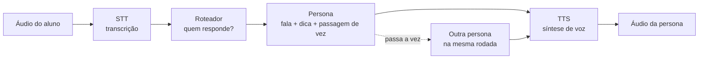
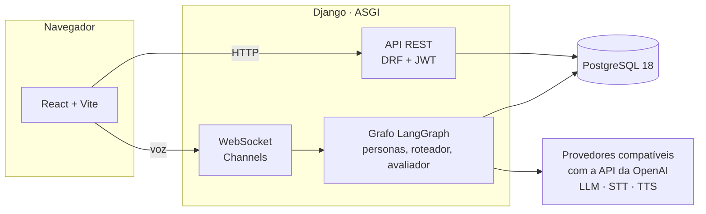

# ConvencendoAI

Sistema multiagente de conversação por voz para praticar inglês falado. O aluno conversa,
em tempo real, com duas personas ao mesmo tempo em cenários realistas — uma entrevista de
emprego, a negociação de um prazo, um problema no hotel — organizados em trilhas. Cada
cenário é uma tarefa com objetivo verificável e critérios de aceite ocultos; ao final, um
agente avaliador dá uma nota de 0 a 100 por uma rubrica ponderada e aponta os erros de
linguagem.

O público são profissionais e universitários brasileiros que já dominam a gramática, mas
travam na conversação.

## Como funciona

1. **Jornada** — o aluno vê as trilhas e os cenários. Cada cenário tem três níveis
   independentes: *Ouvir* (perguntas de sim ou não), *Frases curtas* e *Conversa livre*.
2. **Briefing** — antes de começar, o aluno lê o objetivo, o contexto e quem são as personas.
3. **Sessão ao vivo** — segura o botão para falar e solta para enviar. As personas respondem
   por voz, uma de cada vez, e podem passar a palavra uma para a outra.
4. **Relatório** — nota final, sub-nota por dimensão da rubrica e resultado de cada critério.

Uma rodada da sessão ao vivo passa por estas etapas:



A conversa é um grafo LangGraph (`listen → routing → persona`), com o estado compartilhado
entre as personas. O avaliador roda no fim da sessão, no mesmo ciclo da requisição.

## Arquitetura



| Camada | Tecnologias |
|---|---|
| Frontend | React 19, TypeScript, Vite, Tailwind CSS 4, React Router, TanStack Query, Vitest |
| Backend | Python 3.12, Django 6, Django REST Framework, SimpleJWT, Channels, drf-spectacular |
| Agentes | LangGraph, LangChain, SDK da OpenAI (qualquer provedor compatível) |
| Banco | PostgreSQL 18 |
| Execução | Docker Compose; em desenvolvimento, uvicorn com reload |

Deliberadamente, não há banco vetorial, Redis nem Celery: a memória entre cenários é um
resumo curto escopado à trilha, e nenhum dos três teria trabalho a fazer no escopo atual.

## Estrutura do repositório

```
backend/
  core/              configuração do Django e rotas raiz
  apps/
    users/           usuário e autenticação (registro, token, logout)
    catalog/         trilhas, cenários, níveis, personas e critérios (cadastráveis no admin)
    progress/        tentativas, jornada do aluno e relatório
    agents/          grafo da conversa, personas, roteador e avaliador
    voice/           sessão ao vivo por WebSocket, STT e TTS
    llm/             provedores, modelos e qual modelo atende cada papel
frontend/
  src/
    api/             chamadas à API (uma por recurso)
    services/        sessão do aluno e conexão da sessão de voz
    hooks/           ponte entre os serviços e as telas
    components/      componentes compartilhados
    pages/           entrada, jornada, cenário, sessão ao vivo, relatório
docs/                documentos de apoio
docker-compose.dev.yml
```

## Primeiros passos

Pré-requisito: Docker com Docker Compose.

**Todo o desenvolvimento acontece dentro dos containers.** Rodar `manage.py` ou `npm` direto
na máquina pode falhar, por exemplo quando o caminho da pasta tem acento — dentro do
container o código fica em `/app` e o problema desaparece.

```bash
cp .env.example .env
```

Troque `POSTGRES_PASSWORD` e `DJANGO_SECRET_KEY` no `.env`, e suba os três serviços:

```bash
docker compose up -d --build
```

```bash
docker compose exec backend python manage.py migrate
```

```bash
docker compose exec backend python manage.py createsuperuser
```

As migrations já carregam o catálogo inicial: duas trilhas (*Carreira em TI* e *Viagem e
Intercâmbio*), três cenários, os três níveis e os critérios de cada um.

| Serviço | Endereço |
|---|---|
| Aplicação (frontend) | http://localhost:5180 |
| API | http://localhost:8010/api/ |
| Documentação da API (Swagger / ReDoc) | http://localhost:8010/api/docs/ · http://localhost:8010/api/redoc/ |
| Admin do Django | http://localhost:8010/admin/ |
| Banco (fora do compose) | localhost:5433 |

Todas as portas vêm do `.env` e podem ser trocadas lá.

### Configurar os modelos

No ambiente de desenvolvimento, o backend roda `python manage.py seed_llm` a cada subida, logo
depois das migrations. Com a `GROQ_API_KEY` preenchida no `.env`, ele cadastra a Groq, os modelos
`openai/gpt-oss-20b`, `openai/gpt-oss-120b`, `whisper-large-v3-turbo` e
`canopylabs/orpheus-v1-english`, e preenche os papéis abaixo (persona com o 20b, avaliador e
roteador com o 120b). O sistema já sobe pronto para uso. O seed só completa o que falta: nunca
sobrescreve a chave, os modelos ou os papéis configurados no admin. Um papel esvaziado de propósito é
preenchido de novo na subida seguinte; para usar outro modelo, troque o papel em vez de esvaziá-lo.

Para configurar outro provedor ou outros modelos, use o admin:

1. **LLM providers** — cadastre o provedor com a URL **compatível com a API da OpenAI** e cole
   a chave em **Nova chave**. Um mesmo provedor atende chat e áudio. Exemplo, Groq:
   `https://api.groq.com/openai/v1`. A chave fica criptografada no banco e a tela só mostra o
   começo dela; para trocar, cole a nova na mesma caixa. Trocar o `DJANGO_SECRET_KEY` torna as
   chaves gravadas ilegíveis, e elas precisam ser cadastradas de novo.
2. **LLM models** — cadastre cada modelo com a categoria certa (chat, STT ou TTS) e o
   identificador exato que o provedor espera.
3. **Agent model configs** — escolha qual modelo atende cada papel:

| Papel | O que faz | Exemplo testado |
|---|---|---|
| Persona | fala de cada personagem, a dica e a passagem de vez | `openai/gpt-oss-20b` (Groq) |
| Avaliador | nota e feedback no fim da sessão | um modelo de chat |
| Roteador *(opcional)* | decide quem responde quando o aluno se dirige a uma persona | `openai/gpt-oss-120b` (Groq) |
| STT | transcrição da fala do aluno | `whisper-large-v3-turbo` (Groq) |
| TTS | voz das personas | `canopylabs/orpheus-v1-english` (Groq) |

Sem roteador configurado, a sessão funciona normalmente: quem responde é sempre a persona
da vez. No início de cada sessão, o log do backend mostra qual modelo atende cada papel.

Depois disso, crie uma conta em http://localhost:5180 e comece pela jornada.

## Comandos úteis

```bash
docker compose ps
```

```bash
docker compose logs -f backend
```

```bash
docker compose down
```

Testes do backend:

```bash
docker compose exec backend pytest
```

Testes, checagem de tipos e lint do frontend:

```bash
docker compose exec frontend npm test
```

```bash
docker compose exec frontend npx tsc -b --noEmit
```

```bash
docker compose exec frontend npm run lint
```

Uma sessão completa pelo terminal, por texto, sem voz — útil para testar o comportamento
das personas. `-it` porque a sessão lê a sua fala do teclado; para encerrar antes, envie EOF
(Ctrl+D, ou Ctrl+Z e Enter no Windows):

```bash
docker compose exec -it backend python manage.py run_scenario --user <usuario> --scenario entrevista-de-emprego --level 1
```

Uma migration nova, depois de alterar um model:

```bash
docker compose exec backend python manage.py makemigrations <app>
```

`docker compose down -v` também **apaga o banco**.

## API

Documentação interativa em `/api/docs/`. Resumo:

| Método | Rota | O que faz |
|---|---|---|
| POST | `/api/auth/register/` | cria a conta do aluno |
| POST | `/api/auth/token/` | login: devolve o token de acesso e o de renovação |
| POST | `/api/auth/token/refresh/` | renova o token de acesso |
| POST | `/api/auth/logout/` | invalida o token de renovação |
| GET | `/api/journey/` | trilhas, cenários e o estado de cada nível para o aluno |
| GET | `/api/scenarios/<slug>/levels/<nível>/briefing/` | briefing antes da sessão |
| GET | `/api/attempts/<id>/` | relatório de uma tentativa |
| GET | `/api/health/` | estado da aplicação e do banco |
| WS | `/ws/voice/<slug>/<nível>/?token=<acesso>` | sessão de voz ao vivo |

Na sessão de voz, o cliente envia o áudio de cada turno como mensagem binária e recebe o
áudio das personas da mesma forma. As mensagens de controle são JSON:

| `type` | Quando |
|---|---|
| `session_ended` | a sessão terminou; traz `attempt_id`, `final_score` e `passed` |
| `no_speech` | nenhuma fala foi transcrita; a vez continua do aluno |
| `error` | a sessão foi encerrada por um erro |

## Rede com inspeção TLS

Se o build precisar rodar numa rede corporativa que inspeciona TLS, coloque o `.crt` da
autoridade certificadora em `backend/certs/` e em `frontend/certs/`, e preencha
`CORPORATE_CA_CERT` no `.env`. Detalhes nos READMEs dessas pastas. Fora dessa rede, deixe a
variável vazia.
